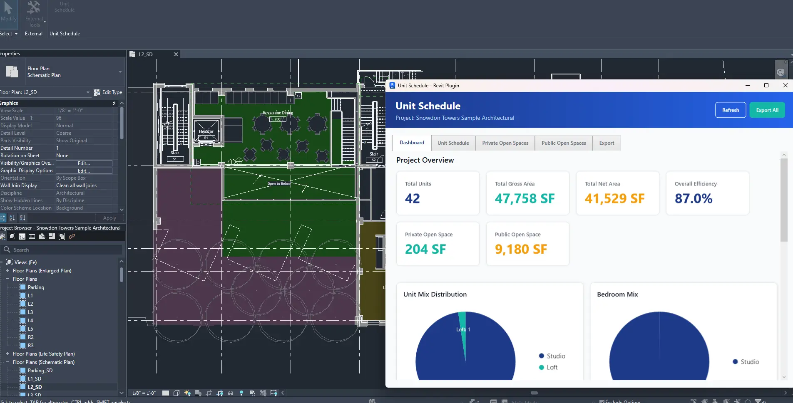
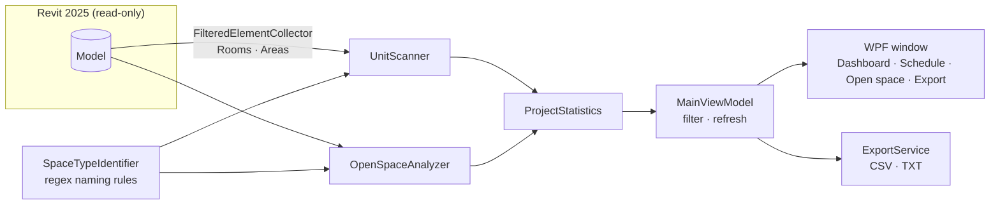
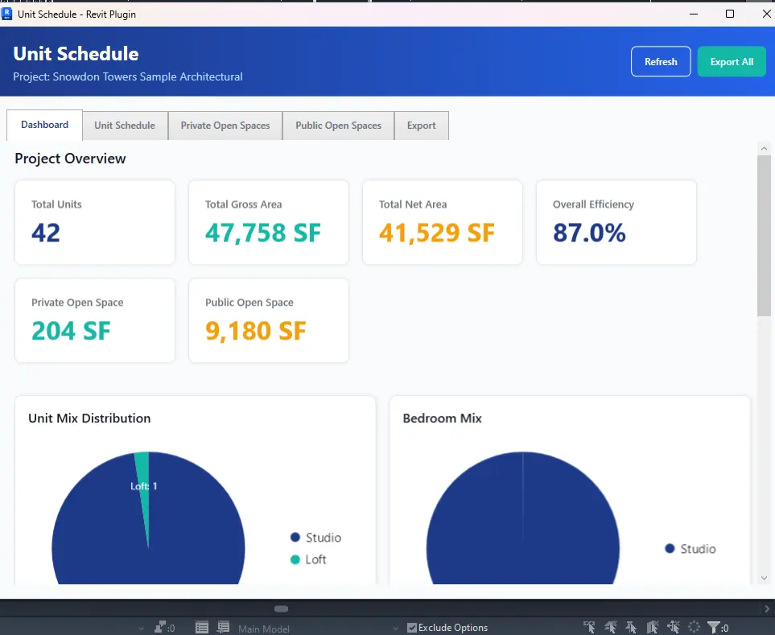
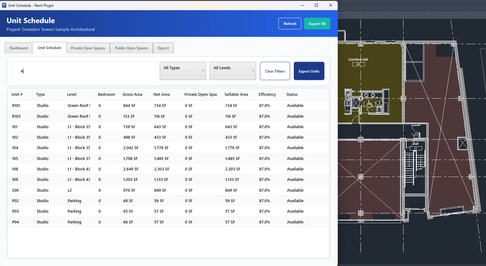
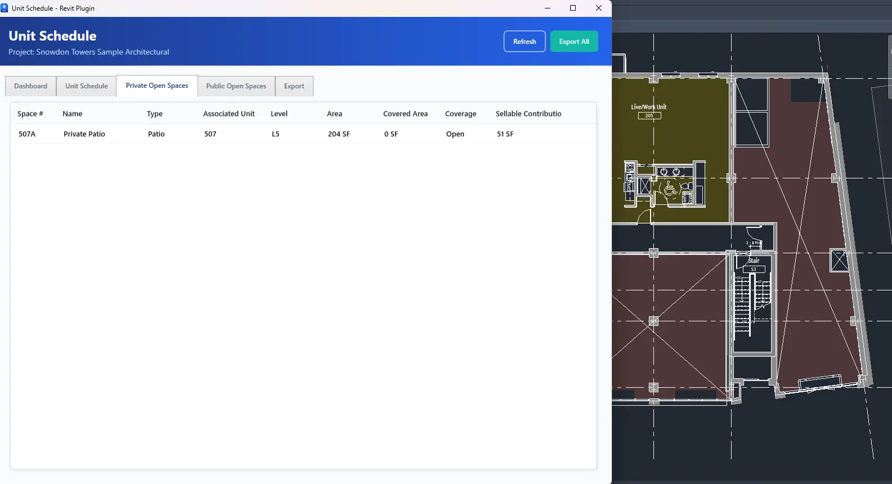
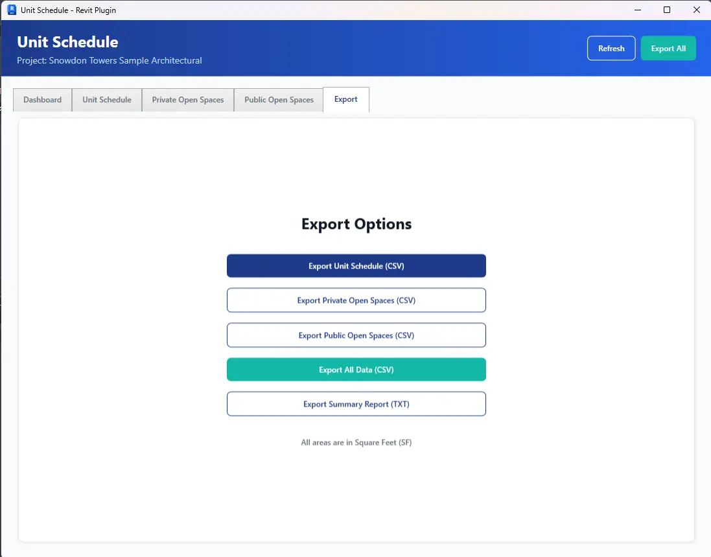

# Unit Schedule

**Unit mix, straight from the Revit model.**

A Revit 2025 add-in that reads a multi-family model's rooms and areas and
turns them into a unit schedule, an open-space tally and a dashboard,
without anyone retyping a number.



<sub>Revit 2025 · .NET 8 · WPF / MVVM · read-only · MIT</sub>

---

## Problem

On multi-family and mixed-use jobs, the unit mix, unit areas and private /
public open space are tallied by hand from the model, for every design
iteration and every submission. The numbers drift from the model the moment
the plan changes, and nobody trusts the spreadsheet.

## What it does

| | |
|---|---|
| **Scan** | Collects every placed Room and Area in the open model. |
| **Classify** | Groups rooms into units by a `Unit Number` parameter when the model has one, otherwise by the room name; reads the type (Studio, 1BR, 2BR, 3BR, Penthouse) from names and bedroom count; sorts balconies, patios and terraces (private) from courtyards, roof decks and amenities (public). |
| **Summarise** | Units, gross / net / sellable area, efficiency, unit-mix and bedroom-mix charts. |
| **Export** | CSV per table, everything in one CSV, or a plain-text summary report. |

## Architecture



- `Command.cs` is an `IExternalCommand` with `TransactionMode.ReadOnly`:
  the add-in can never change the model.
- `SpaceTypeIdentifier` holds every naming rule in one place, so supporting
  a firm's own room-naming convention is a change to one file.
- Pure WPF, no third-party UI or chart packages: nothing extra to approve
  or install on a locked-down workstation.

## Demo

| Dashboard | Unit schedule |
|---|---|
|  |  |
| **Private open space** | **Export** |
|  |  |

Captured on Autodesk's *Snowdon Towers* sample model: 42 units,
47,758 SF gross, 41,529 SF net, 87.0 % efficiency, 204 SF private and
9,180 SF public open space.

### Try it in five minutes

1. Build (below) and copy `UnitSchedulePlugin.dll` + `UnitSchedulePlugin.addin`
   into `%APPDATA%\Autodesk\Revit\Addins\2025\`.
2. Open any model with placed rooms (the Snowdon Towers sample works).
3. **Add-Ins → Unit Schedule**. Filter by type or level, then **Export**.

## Install / build

There is no prebuilt release yet: build from source.

Requirements: Windows 10/11 x64, Revit 2025, .NET 8 SDK (or Visual Studio 2022).

```bash
git clone https://github.com/EthanAlong/UnitSchedulePlugin.git
cd UnitSchedulePlugin/UnitSchedulePlugin
dotnet build -c Release
```

The project references `RevitAPI.dll` / `RevitAPIUI.dll` from the default
Revit 2025 install folder; edit the paths in `UnitSchedulePlugin.csproj` if
yours differs.

### Naming rules it understands

| Room name | Read as |
|---|---|
| `Unit 101 - Living`, `101-LR` | Unit 101 |
| `Studio`, `Bachelor` | Studio |
| `1BR`, `1 Bedroom`, `One Bed` | 1 Bedroom |
| `Balcony`, `Patio`, `Terrace` | Private open space |
| `Courtyard`, `Amenity`, `Pool` | Public open space |

## Design decisions

- **Read-only by construction.** A schedule tool has no reason to write, and
  a read-only transaction is what makes it safe to run on a live central model.
- **Naming conventions over new parameters.** Most models already encode
  the unit in the room name; asking a team to add shared parameters first
  is where adoption dies. A `Unit Number` (or `Apartment Number`) parameter is used when it exists.
- **Imperial only.** Built for US multi-family work; every area is SF.

## Limitations / next

- **Gross area is estimated** as net × 1.15 (walls ≈ 15 %), not measured,
  unless Area elements are present. Next: read gross from an Area scheme.
- Unit detection is only as good as the room naming; a room no rule matches
  is reported as `Unknown` rather than guessed.
- No binary release or installer yet; Revit 2025 only.

## Project structure

```
UnitSchedulePlugin/
├── Command.cs              IExternalCommand entry (read-only)
├── Helpers/                SpaceTypeIdentifier (naming rules), ColorPalette
├── Models/                 UnitInfo, OpenSpaceInfo, ProjectStatistics
├── Services/               UnitScanner, OpenSpaceAnalyzer, ExportService
├── ViewModels/             MainViewModel, RelayCommand
└── Views/                  MainWindow.xaml (+ code-behind)
```

Product notes: [`Prd_RevitUnitSchedulePlugin.MD`](Prd_RevitUnitSchedulePlugin.MD).

## License

MIT, see [LICENSE](LICENSE).
